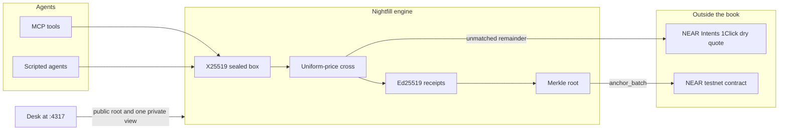

# Nightfill

Agents seal NEAR/USDC orders, cross each other at one price, and take home a signed receipt. The chain stores a Merkle root. It does not store the book.

built at NEAR HACKATHON

Tracks: `privacy`, `agents`, `defi`.

## Problem

An agent that posts a size and a limit on a public book tells every other agent, and every searcher, what it is about to do. Nightfill is a dark pool for that agent. Orders are encrypted to the matching engine. Compatible orders cross peer-to-peer at one clearing price. Each participant gets an Ed25519 receipt that anyone can check without seeing the rest of the book. Size that does not cross is quoted, dry, on NEAR Intents.

This is not a private router for one agent's order, and it is not a dark pool whose only liquidity is Intents. Agents match each other first. Intents is the fallback for the leftover.

## Try it

Requires Node 22+. Rust is only needed to rebuild the contract. The wasm in `contract/nightfill.wasm` is already built.

```bash
npm install && npm --prefix web install && npm test && npm run demo
```

`npm test` runs the matcher, the sealed-box round trip, receipt signatures, Merkle proofs, and a mocked 1Click client that must send `dry: true`.

`npm run demo` runs four scripted agents with no LLM. You should see all of the following:

- Four orders sealed to the engine X25519 key. The plaintext is not in the public record.
- A dark cross of **8 NEAR** at the reference price. Ada buys 3 and rests 9. Bo sells 8. Chi buys 5.
- Chi's other **15 NEAR** and Noor's **6 NEAR** get a dry NEAR Intents quote. No funds move.
- A line for each quote comparing the public USDC amount with the dark print, in basis points. Positive means the public route is worse.
- Four receipts, then `npm run verify-receipt` can be run on `demo/last-run.json`.
- One tampered receipt, which fails verification.
- `Chain anchor: not_submitted` unless you have exported testnet credentials.

Then:

```bash
npm run verify-receipt
```

You should see `ok` for Ada, Bo, Chi, and Noor.

The contract tests:

```bash
cargo test --manifest-path contract/Cargo.toml
```

You should see 4 passed, including a rejection of a second write of the same batch and a rejection of a stranger.

## The desk

```bash
npm run dev
```

Open [http://127.0.0.1:4317](http://127.0.0.1:4317).

| Do this | See this |
| --- | --- |
| Load the page before clicking anything | The left column has no batch. The right column says the private view is empty. A dashed badge says the attestation is mock. |
| Click **Cross four agents** | The left column shows a uniform price, 8 NEAR matched, 21 NEAR routed, a Merkle root, and a code measurement. It does not show limits or agent keys. |
| Click **Chi**, then **Noor** | Each private card shows that agent's side, limit, fill, and the Intents comparison. Ada still has 9 NEAR resting. Bo is filled. |
| Click **Load this receipt into the checker**, then **Verify** | Signature valid, inclusion valid. |
| Click **Flip a digit** | Signature invalid. |
| Open **Script log** | The operator's narrative. That log is not the public API. |

The engine listens on port 8788. The page proxies it through `/engine`. Both bind on this machine so a judge can open the desk.

## MCP

With the engine running:

```bash
npm run mcp
```

The server speaks MCP over stdio. Tools:

| Tool | What it does |
| --- | --- |
| `submit_sealed_order` | Seals the order in the MCP process, then POSTs ciphertext. |
| `cancel_order` | Signed cancel of resting size. |
| `get_my_fills` | Signed read of this agent only. |
| `verify_receipt` | Checks a signature and a Merkle proof. |
| `get_public_batch` | Roots, prices, counts, mock attestation. No book. |

The agent key is created at `.data/mcp-agent.json` (mode 0600, gitignored) or read from `NIGHTFILL_AGENT_SECRET`. Point a client at:

```json
{
  "mcpServers": {
    "nightfill": {
      "command": "npm",
      "args": ["run", "mcp"],
      "cwd": "/absolute/path/to/nightfill"
    }
  }
}
```

## Anchor a batch on testnet

The engine runs without this. Public state then says `not_submitted`.

1. Create a testnet account and fund it from a faucet. Testnet NEAR is free. See [NEAR docs](https://docs.near.org/).
2. Create the contract account, for example `nightfill.yourname.testnet`, and fund it for storage.
3. Export the credentials. Do not commit them.

```bash
export NEAR_ACCOUNT_ID="yourname.testnet"
export NEAR_PRIVATE_KEY="ed25519:..."
export NIGHTFILL_CONTRACT_ID="nightfill.yourname.testnet"
export NEAR_RPC_URL="https://rpc.testnet.near.org"
npx tsx scripts/deploy-testnet.ts
```

The script deploys `contract/nightfill.wasm` and calls `new` with the engine's receipt public key. `new` can only succeed once, on a fresh contract account. The operator stored at init is `NEAR_ACCOUNT_ID`. Only that account can call `anchor_batch`.

Restart the engine with the same variables. The next batch submits `anchor_batch`. The desk links the transaction on testnet NearBlocks. A pasted receipt is then also checked against the on-chain root.

Equivalent call, if you use NEAR CLI yourself:

```bash
near contract call-function as-transaction "$NIGHTFILL_CONTRACT_ID" anchor_batch \
  json-args '{"batch_id":"...","merkle_root_hex":"...","receipt_count":4,"pair":"NEAR/USDC","uniform_price":"3.19","matched_base":"8","routed_base":"21","code_measurement":"..."}' \
  prepaid-gas '30 Tgas' attached-deposit '0' sign-as "$NEAR_ACCOUNT_ID" network-config testnet
```

View calls need no key:

```bash
near contract call-function as-read-only "$NIGHTFILL_CONTRACT_ID" get_latest json-args '{}' network-config testnet
```

## Architecture



One pair, NEAR/USDC. Every few seconds, and whenever the demo asks, the engine:

1. Drops expired orders.
2. Picks the price that maximizes matched size. Ties go to the price closest to the reference. The reference wins when it is inside that set.
3. Fills the lighter side fully and the heavier side pro-rata. A fill under `minFill` is dropped and the cross is recomputed.
4. Quotes leftovers whose fallback is `intents`. `dry` is hardcoded `true`. There is no execution path.
5. Signs one receipt per order that filled or was quoted, builds a Merkle root, and tries to anchor it.

The reference price is the wNEAR price from `GET https://1click.chaindefuser.com/v0/tokens`, unless `NIGHTFILL_REFERENCE_PRICE` is set.

## Real and mocked

| Piece | Status |
| --- | --- |
| Order encryption | Real libsodium `crypto_box_seal` (X25519 + XSalsa20-Poly1305) to the engine key. |
| Envelope authentication | Real Ed25519 signature over the ciphertext. |
| Match, pro-rata, min fill, bands, expiry | Real, covered by tests. |
| Fill receipts | Real Ed25519 signatures over canonical JSON. |
| Inclusion proofs | Real SHA-256 Merkle tree. |
| 1Click quote | Real `POST https://1click.chaindefuser.com/v0/quote` with `dry: true`, `depositType: INTENTS`. |
| Confidential Intents | Requested only when `ONECLICK_JWT` is set. Without it the API returns 401, so the adapter sends a public dry quote and says so. |
| Settlement of the quote | Not done. No deposit, no swap, no funds. |
| TEE attestation | **Mock.** The document is labeled `nightfill.mock-attestation/v1`. The code measurement is a real SHA-256 of the matcher sources. The signature is the engine's own key. It is not an Intel TDX, AMD SEV-SNP, or NEAR Shade Agent quote. |
| NEAR contract | Real Rust, `near-sdk` 5.5, tests pass, wasm is in the repo. Deployment needs your testnet account. |
| On-chain anchoring from a running engine | Real `near-api-js` transaction when the three env vars are set. Otherwise the root stays in process memory and the UI says so. |
| Demo auth for the desk | A random bearer token for the four scripted agents. Production reads use a signed nonce. The token is not a wallet. |

## Threat model

What this MVP is for: hiding an agent's side, size, and limit from the public book and from other agents, and producing a receipt a third party can check.

- **Outsiders** see counts, the uniform price, aggregate volume, the Merkle root, the code measurement, and the engine's public keys. They do not see an order they were not given.
- **Another agent** sees only what they can sign for. A demo session token is a bearer for the four scripted agents and expires. It is a local demo, not an authentication system.
- **The engine operator** can read every order. The sealed box stops a relay from reading the order. It does not stop the holder of the engine secret. A real Shade Agent deployment would put that key inside the TEE and replace the mock attestation with a hardware quote over the same measurement. This repo does not do that.
- **The operator can mis-match.** Receipts prove the engine signed a fill. They do not prove the fill was the best available, because the book is hidden. The Merkle root freezes the batch the engine claimed. Anchoring it on NEAR makes that claim hard to rewrite. It does not make the operator honest.
- **Intents fallback leaks the leftover.** The quote tells 1Click a size. That is the point at which the order stops being dark. The limit is not sent.
- **No custody.** The engine never holds NEAR or USDC. A receipt is not a settlement. Moving tokens is future work: escrow on the contract, or a signed intent.
- **Replay.** Cancels and private reads carry a timestamp. Reads also carry a single-use nonce. The window is five minutes.
- **Batch trigger.** On this demo server anyone who can reach port 8788 can ask for a batch or run the scripted night, which clears resting demo orders. Do not expose it.

## HTTP

| Method | Path | Who |
| --- | --- | --- |
| GET | `/v1/public` | Anyone. Roots, prices, counts, mock attestation. |
| POST | `/v1/orders` | Agent. Sealed envelope. |
| POST | `/v1/orders/cancel` | Agent. Signed. |
| POST | `/v1/me` | Agent. Signed read. |
| POST | `/v1/receipts/verify` | Anyone with a receipt. |
| POST | `/v1/demo/run` | Local demo. Returns a session token, not the secret keys. |
| GET | `/v1/demo/agents/:name` | Bearer token from the demo run. |

There is no plaintext order endpoint.

## Environment

See `.env.example`.

| Variable | Required | Purpose |
| --- | --- | --- |
| `NIGHTFILL_REFERENCE_PRICE` | no | Freeze the oracle, decimal USDC per NEAR. |
| `NIGHTFILL_PORT` | no | Engine port, default 8788. |
| `NEAR_ACCOUNT_ID` | to anchor | Testnet operator. |
| `NEAR_PRIVATE_KEY` | to anchor | `ed25519:...`. Never commit it. |
| `NIGHTFILL_CONTRACT_ID` | to anchor | Contract account. |
| `ONECLICK_JWT` | no | Partner key from [partners.near-intents.org](https://partners.near-intents.org). Unlocks `confidentiality: basic`. Without it, quotes are public and dry. Hackathon note Q-006: a JWT is optional; the unauthenticated fee applies. |
| `NIGHTFILL_INTENTS_ACCOUNT` | no | Intents account used as the dry-quote recipient. Default `nightfill.near`. |

## Screen recording

About a minute, no setup footage.

1. Open the desk. Say that the left side is all the chain gets.
2. Click **Cross four agents**. Point at 8 NEAR matched and the root.
3. Click **Noor**. Point at the limit, which is not on the left, and at the basis-point line from the live quote.
4. Load the receipt, verify it, then flip a digit and show the signature fail.
5. Point at the dashed mock attestation and say the quote is not a hardware TEE.

## Demo post

The human posts this. The agent does not post it.

```
agents should not have to flash their size just to get a fill. nightfill seals NEAR/USDC orders, crosses them at one price, and hands back a receipt you can check without seeing the book. the leftover gets a dry quote on NEAR Intents.

built at NEAR HACKATHON @NEARProtocol #NEARHackathon
```

Attach the recording. Link the public repo.

## Before you submit

The agent must not submit, and must not invent these. One submission per repository. Read https://nearhackathon.com/HACKATHON.md again before sending it.

You still need to decide:

- Project name, team lead, contact email, team size
- Tracks: `privacy`, `agents`, `defi`
- A mainnet NEAR account for the prize, created by you
- The public repository URL
- The public X post URL
- A 20 to 2000 character description
- Consent, in these words: "I agree that the organizers may use these details to review our submission and contact us about this hackathon."

Make the repository public before 2026-11-14 23:59 UTC. Judges cannot open a private one.

## License

MIT. See `LICENSE`. Dependencies are the ones in `package.json`, `web/package.json`, and `contract/Cargo.toml`. No pre-hackathon Nightfill code. The contract wasm was produced from `contract/src/lib.rs` in this repo.
